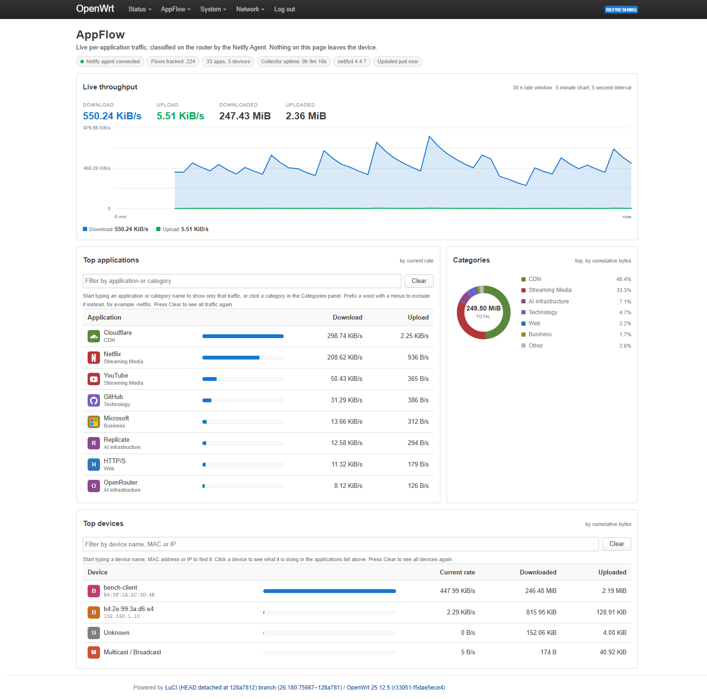
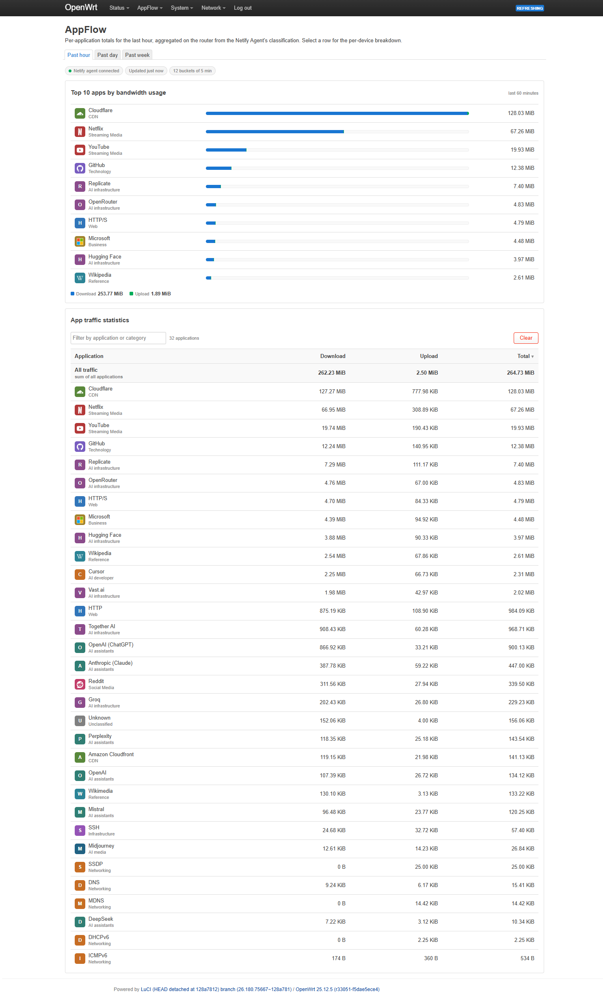
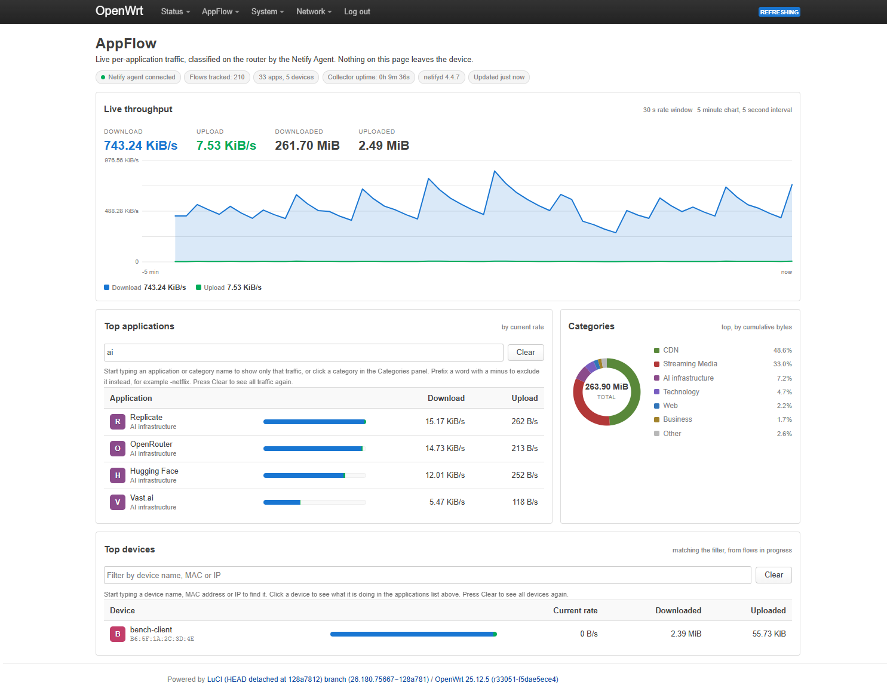

# luci-app-appflow

**Real-time per-application traffic visibility for OpenWrt.**

`appflow` answers the question stock OpenWrt cannot: *what is my network doing
right now, by application?* Netflix vs. YouTube vs. a Windows update, broken
down per device, live in LuCI, built entirely on open components.

> Status: **working, published as a demonstration project.** Developed and
> tested on real hardware, with byte-attribution behavior measured rather than
> assumed. Read *Known limitations* below before installing: several are
> inherent to the DPI engine, and one affects anyone who restarts the service.
> Not in the OpenWrt feeds yet, so the package below is unsigned.

## Install

One file, every device. The package is `noarch` — only JavaScript and ucode
inside — and the same `.apk` is verified installing on both aarch64 and
arm_cortex-a15 hardware.

    wget -O luci-app-appflow-1.1.3-r1.apk https://github.com/VolanticSystems/luci-app-appflow/releases/download/v1.1.3/luci-app-appflow-1.1.3-r1.apk
    apk add --allow-untrusted ./luci-app-appflow-1.1.3-r1.apk
    /etc/init.d/appflowd enable && /etc/init.d/appflowd start

Needs OpenWrt 25.12 or newer and `netifyd`. `--allow-untrusted` is required
because this is not signed by the OpenWrt build key. Optional icon pack and
Simplified Chinese translation are on the same
[releases page](https://github.com/VolanticSystems/luci-app-appflow/releases).

Prefer to build it yourself? See *Building from source* below.

## Screenshots

Live overview:



Statistics (past hour):



Filtering. Typing `ai` narrows both lists to AI traffic, and the device panel
switches to what currently-tracked flows account for:



## How it works

    netifyd (DPI engine, nDPI-based)
        │  JSON flow events (unix socket)
        ▼
    appflowd (ucode daemon: aggregates flows → apps × devices)
        │  ubus
        ▼
    LuCI view (hand-drawn inline SVG charts, live polling)

There is no database and no polling of the DPI engine: `appflowd` holds a live
aggregate in memory and publishes it over ubus. Design notes, including the
netifyd 4.4.7 event contract as observed on real hardware, are in
[docs/DESIGN.md](docs/DESIGN.md).

`appflow` itself contacts no network service: it reads a local socket and
publishes over ubus, with no account, key or registration of any kind.

`netifyd` is a separate package with its own configuration and its own
vendor-supplied signature data, so appflow cannot speak for it. It was measured
rather than assumed. On the development router, after 4 days 23 hours of
uptime, netifyd held 16 sockets: 12 unix and 3 packet capture, and **zero TCP
or UDP sockets**, with no outbound connection at any point. The agent does have
a telemetry sink, and OpenWrt's packaged `/etc/netifyd.conf` ships it turned
off:

    [netifyd]
    dump_established_flows = yes
    enable_sink = no

`enable_sink = no` is the line that matters. Check it on your own install
rather than trusting this one: it is netifyd's setting, not appflow's, and
anyone can change it.

The line above it is quoted only because it is really there. **It does
nothing on 4.4.7**: the string `dump_established_flows` does not appear in the
shipped binary at all, while `enable_sink` does. It is a stale key in the
packaged config, and if you were hoping it means the agent will replay
established flows to a client that connects late, it does not. That is the
cause of the "Unknown" limitation below, not something a setting can turn off.

## How it compares

`nlbwmon` is the usual answer to "what is using my bandwidth" on OpenWrt, and
it is the first thing worth checking before installing this.

| | `nlbwmon` | `appflow` |
|---|---|---|
| Axis | Per host, per protocol and port | Per application, per host |
| How it identifies traffic | Conntrack accounting | DPI, via netifyd |
| Storage | Persistent database, survives reboot | In memory only, live view, keeps nothing |
| Range | Days and months | Live, plus past hour |
| Cost | Under 1 MB VSZ for the daemon | netifyd, around 17 MB VSZ, plus about 2 MB for appflowd |

They answer different questions, and both were run on the same router at the
same time on identical traffic to check they can be: nlbwmon reported HTTP
9.99 MB and HTTPS 2.09 MB; appflow reported the same traffic as cloudflare,
github and wikipedia. Neither interfered with the other. If you want durable
per-host accounting, nlbwmon does it better and appflow does not attempt it;
if you want to know which *application* is doing it right now, that is the
question this package exists to answer.

## AI services get their own rows

netifyd cannot classify AI traffic and will not soon. Its signature set is
dated **August 2023**, carries 199 applications, and contains no AI vendor at
all, so anything from Claude to Midjourney lands in generic HTTP/S.

The identifying data is already present: netifyd reports the TLS SNI, and
appflow already stores it. So appflow matches that name against a built-in
table of eighty-five AI service domains and gives them their own application
rows and four categories: assistants, media, developer tools and
infrastructure (aggregators, inference APIs, GPU rental, vector stores).

**This is hostname matching, not DPI, and it is labelled as such.** It asserts
a classification netifyd did not make. netifyd's own answer always wins except
for a handful of services whose parent brand it recognizes and would otherwise
swallow (Gemini under Google, Copilot under GitHub), so the table falls silent
by itself if Netify ever ship AI signatures.

Matching is anchored on label boundaries, never a substring, so
`anthropic.com.attacker.example` is not labelled Anthropic. It changes an
identity and never a byte: byte conservation is asserted across a batch
containing AI flows.

Turn it off with `option ai_breakout '0'` in `/etc/config/appflow`. Two things
it cannot do: match a service behind a shared CDN hostname, and survive ECH,
which encrypts the SNI. netifyd has the same ECH exposure. Detail in
[docs/DESIGN.md](docs/DESIGN.md) section 11.

## Finding things in a busy dashboard

One streaming session can bury everything else, so both lists filter.

**Type to narrow.** The box above the application list matches the application
name, its internal key and its category, so `ai` finds every AI service and
`streaming` finds every streaming one.

**Prefix a word with a minus to exclude it.** `-netflix` shows everything
except Netflix, which is the case a search box alone cannot express: to use it
you would have to already know what you wanted to keep. Terms combine, so
`ai -claude` is AI traffic that is not Claude.

**Click anything that names something.** A category in the Categories panel, an
application name, or the category under it: each fills the filter box, so the
click is visible, editable and clearable rather than a hidden mode.

**Click a device to see what it is doing.** The application list then shows only
that device's traffic and a chip appears naming it. The device list has its own
filter box matching name, MAC and IP, with the same minus-to-exclude behavior.

Both filters compose: pick a device, then type `-netflix`, and you get that
device's traffic minus streaming.

### What the numbers mean when you drill in

A device drill-down is computed from the live flow table, not from a stored
per-device-per-application history, so the columns change from **Download and
Upload rates** to **Downloaded and Uploaded bytes** and the caption says
"from flows in progress". Those are the bytes currently-tracked flows account
for: a connection that has already finished is no longer in the table.

That is a real limitation and it is why the headings change rather than leaving
a byte figure sitting under a column promising a rate. Producing a genuine
per-device-per-application *rate* would need a delta ring for every pair, which
is the unbounded state this design avoids on purpose.

## Teaching it a service it does not know

netifyd's signature set is vendor data and it goes stale: the copy shipped with
OpenWrt is dated August 2023. AppFlow recognizes services by the server name
their TLS connections announce, and you can add to that list yourself without
touching any code.

Add a section to `/etc/config/appflow`:

```
config hostmap
	option suffix 'torproject.org'
	option name 'Tor'
	option category 'Privacy'
```

then `/etc/init.d/appflowd restart`. Traffic to `www.torproject.org` and
`check.torproject.org` now appears as **Tor** under **Privacy**.

| option | meaning |
|---|---|
| `suffix` | matched against the last two, three or four labels of the server name, anchored on a label boundary. Must contain a dot. |
| `name` | what appears in the application list. |
| `category` | what appears in the category breakdown. Free text; reuse an existing one to group with it, or invent your own. |
| `strong` | optional, default `0`. `0` fills a gap only, leaving netifyd's own identification alone where it has one. `1` overrides netifyd too, for when it recognizes a parent brand and swallows the service inside it. |

**The same section overrides a built-in entry**, so this is also how you correct
one that is wrong for your network:

```
config hostmap
	option suffix 'anthropic.com'
	option name 'Work AI'
	option category 'Business'
```

Matching is anchored on label boundaries, so `torproject.org` matches
`check.torproject.org` and **not** `torproject.org.example.com`, which anyone
can register. A malformed entry is skipped and named in the log rather than
silently ignored, because a typo otherwise looks exactly like the feature not
working:

```
logread -e appflowd | grep hostmap
```

This is name recognition, not deep packet inspection, and it inherits the same
limits: a service behind a shared CDN hostname is invisible, and ECH would end
it. Thirteen checks in `tests/protocol-suite.sh hostmap` cover it.

## Known limitations

Read these before installing. They are measured and documented rather than
left to be discovered. Details and supporting measurements are in
[docs/DESIGN.md](docs/DESIGN.md) sections 2.5 and 8.

- **All statistics live in memory and do not survive a restart.** There is no
  database, by design. Restarting `appflowd`, restarting netifyd, or rebooting
  starts the past-hour view from empty. If you need history across restarts,
  this package does not currently provide it.
- **Flows in progress across a restart are attributed to "Unknown".** netifyd
  4.4.7 sends counter updates for a flow that was already established when
  `appflowd` connected, but never the event carrying its identity, so those
  bytes accumulate under "Unknown" until the flow ends. Measured: restarting
  the daemon mid-transfer moved 10.7 MB of a correctly classified HTTP flow.
  It is bounded to the window after a restart, resolves as connections cycle,
  and loses no byte totals. A future version could mitigate the
  `appflowd`-restart case by checkpointing its own identity map; the case where
  *netifyd* restarts cannot be fixed without support from netifyd.

  Accuracy across a restart was measured in 1.0.2 against the client's own
  interface counter: 0.89 and 1.01 of wire truth on two runs, against 0.70 and
  0.79 before that release, with a no-restart control at 1.01. If you want an
  exact figure, take it after the restart window rather than across it.
- **Accurate accounting for clients behind NAT needs conntrack.** netifyd
  reports the WAN-side capture of a NAT'd flow using the router's own address,
  which is indistinguishable from traffic the router originated. appflow
  resolves it by looking the flow up in `/proc/net/nf_conntrack`, which is
  present on any normal OpenWrt firewall install. Measured against interface
  counters: client traffic 99.8% and router traffic 97.9% of actual, each
  counted once. **If conntrack cannot be read**, appflow keeps client
  accounting correct and stops attributing the router's own traffic, rather
  than double-counting; it logs one warning saying so. Check
  `ubus call appflow status` under `conntrack` to see which mode you are in.
- **Late re-classification may leave early bytes under "Unknown".** If netifyd
  identifies a flow only after several packets, bytes counted before that point
  are not retroactively moved, because the accounting path is deliberately
  append-only. Not observed in practice and currently unquantified.
- **Flow offloading is untested.** appflow has not been run on a router with
  software or hardware flow offloading enabled. netifyd captures packets on the
  interface rather than through netfilter, so the two paths are not obviously
  in conflict, but that is reasoning and not a measurement, and no measurement
  has been made. Reports from anyone running offloading are welcome.
- **Detection quality is netifyd's, not ours.** Which applications are
  recognized, and how accurately, is a property of the DPI engine and its
  signature data. appflow reports what netifyd detects.
- **This inspects traffic.** Consider whether deep packet inspection is
  appropriate on your network, and for the people using it, before installing.

On accounting accuracy: measured against client-side ground truth, appflow
accounted for **at least** every byte transferred and never lost any (25 flows
of 2 MB gave 50,000,000 bytes transferred against 51,127,054 accounted; 150
flows of 1 KB were all accounted). The roughly 2% excess is consistent with
protocol overhead being counted, but it has not been reconciled packet by
packet, so treat these totals as a close upper bound rather than an exact
byte count.

**If something looks wrong with the numbers**, run `ubus call appflow status`.
Three fields there answer most questions:

| field | what a non-zero value means |
|---|---|
| `bytes.leaked` | **Should read 0.** Traffic was reported by the agent and never reached an aggregate. If this moves, please tell me. |
| `aggregates.refused` | A per-class table filled with live entries, so new applications or devices stopped being tracked. The dashboard is incomplete. Nothing is being mis-counted; the totals stay correct. |
| `flows.shed` | The flow table hit `flow_max` and the least recently active flows were evicted to make room. Raise `flow_max` if this climbs steadily. |

`flows.shed` is counted separately from `flows.pruned`, which is ordinary
housekeeping of idle flows and is expected to be large. Reading them as one
number hides cap pressure underneath normal behavior.

## Security and privacy

Traffic monitoring is a privacy question by definition, so here is the whole
surface. Everything below is checkable in `root/usr/sbin/appflowd` and
`root/usr/share/rpcd/acl.d/luci-app-appflow.json`.

**It runs as root, because it has to.** The daemon reads netifyd's agent socket
and `/proc/net/nf_conntrack`, neither of which is readable otherwise. There is
no privilege drop. If that is not acceptable on your box, do not install it.

**It reads four files and writes none.** `/etc/netify.d/netify-categories.json`,
`/tmp/dhcp.leases`, `/var/run/netifyd/status.json` and `/proc/net/nf_conntrack`,
all read-only, plus its own UCI config at start-up. It contains no `writefile`,
no shell-out and no `popen`. It opens no listening socket: it connects out to
netifyd's Unix socket and publishes a ubus object, which is the local bus and
not the network.

**Nothing is stored.** There is no database, no log of who visited what, no
spool file. Every counter lives in memory and dies with the process, so
`/etc/init.d/appflowd restart` is a complete erase. That is also the honest
limitation: there is no history, and restarting the router loses the day.

**The ubus surface is six read methods and one write, and the write is
`reset`.** The ACL is deliberately narrower than the daemon:

| method | granted to the web UI | what it returns |
|---|---|---|
| `summary`, `stats`, `status` | yes | totals, time series, health |
| `devices`, `apps` | yes | per-device and per-application aggregates |
| `app_detail` | yes | one application: its devices, and the hostnames it contacted, each with byte totals |
| `flows` | **no** | the live per-connection table, including remote addresses and ports |
| `reset` | yes (write) | clears the counters |

**`flows` is ungranted on purpose and the reason is written into the ACL file
itself.** That is the difference between a dashboard and a surveillance log. A
LuCI session can see that a device used a streaming service and that the
service contacted a set of hostnames; it cannot pull the connection table and
join a specific device to a specific remote endpoint, because `app_detail`
returns devices and hostnames as two separate lists for one application rather
than as a cross product.

**What the dashboard does reveal**, so nobody is surprised: DHCP hostnames, MAC
and IP addresses of LAN devices, which applications each device used, and the
TLS SNI hostnames each application contacted. Anyone who can log into LuCI can
see all of it. On a family router that is a real consideration and it is your
call, not the package's.

**Bounded tables that refuse rather than lie.** Aggregate tables are capped. At
the cap the daemon evicts only entries with no live flow, and when every slot is
busy it refuses to grow rather than dropping data that is still arriving, so the
totals stay correct while the breakdown goes incomplete. That refusal used to be
invisible; it is now counted and reported as `aggregates.refused`, because a
table that has quietly stopped accepting new devices looks identical to a quiet
network.

**Reporting something.** If you find a problem, open an issue on the repository,
or send it privately if you would rather not post it. Either is fine, and either
gets an answer.

## Tests

Three suites, 179 checks, no failures. Two need a sandbox router; one needs
nothing but Node and runs on every push.

| suite | checks | what it does |
|---|---|---|
| `tests/frontend-suite.js` | 59 | loads the real view code under Node. Mostly regression tests for defects that shipped. |
| `tests/protocol-suite.sh` | 104 | replaces the agent with a socket the test controls, so byte arithmetic is checked against hand-computed totals rather than a tolerance band, and the error paths a real agent never produces get exercised. |
| `tests/hardware-suite.sh` | 16 | drives real traffic and compares against the client interface's own counter in `/sys/class/net`, which nothing in this daemon can influence. |

Two of the hardware checks SKIP, loudly and counted, when the router cannot
support them: when netifyd is not capturing every default-route interface a
wire-ratio comparison is meaningless rather than merely weak, and the
purge-rate check needs more flows than a quiet bench produces. A skipped
check is reported as skipped, never as a pass.

Every check names, in a comment written before the assertion, the smallest
edit to the *product* that turns it red, and those sabotages are actually
run. That is what caught three checks in the 2026-08-27 round that could
not fail at all, two of them in the group written to prove the AI matcher
refuses lookalike domains.


Every check carries a comment naming the edit to the *product* that turns it
red, written before the assertion. Details in
[CONTRIBUTING.md](CONTRIBUTING.md).

## Requirements

- OpenWrt with `netifyd` available (developed and tested against **OpenWrt
  25.12.5** with **netifyd 4.4.7**, the version OpenWrt packages).
- **netifyd 5.x** works from 1.1.3, tested on x86 with Netify's own 5.2
  packages. It needs two of its plugins switched on, which ship off:
  `netifyd --enable-plugin proc-core`, `netifyd --enable-plugin sink-socket`,
  and in `/etc/netifyd/netify-proc-core.json` set
  `sinks.sink-socket.default.enable` to `true`. appflow finds the 5.x socket
  by itself. If it is connected but nothing arrives for a minute, the status
  page says so and the log says what to switch on.
- Enough headroom to run DPI. Measured on the test device under light load:
  **netifyd** around 17 MB VSZ, **appflowd** around 2 MB VSZ, negligible CPU
  for both. netifyd is the expensive component; appflow adds little on top.

Tested on a Linksys EA8500 (ipq806x). It is architecture-independent
(`LUCI_PKGARCH:=all`), and CI builds it for `arm_cortex-a15_neon-vfpv4` and
`aarch64_cortex-a53`.

## Building from source

Prefer to compile it yourself, or running an OpenWrt release older than
25.12 where the `.apk` above will not install? Build it with the OpenWrt
SDK for your release, then install the resulting package.

Build:

    # from an OpenWrt SDK tree matching your device's release
    ./scripts/feeds update -a
    ./scripts/feeds install -a
    git clone https://github.com/VolanticSystems/luci-app-appflow.git \
        package/luci-app-appflow
    make package/luci-app-appflow/compile V=s

The optional icon pack is a separate package in the same tree, so build it
separately if you want it:

    make package/luci-app-appflow-icons/compile V=s

Install on the device (copy the built package over first):

    apk add --allow-untrusted /tmp/luci-app-appflow-[0-9]*.apk

Note the `[0-9]` in that glob: a plain `luci-app-appflow-*.apk` would also
match `luci-app-appflow-icons-*.apk` and pull in the optional icon pack.

`--allow-untrusted` is required because a locally built package is not signed
by an OpenWrt repository key. On releases still using opkg, use
`opkg install ./luci-app-appflow_*.ipk` instead.

### Optional icon pack

`luci-app-appflow-icons` adds brand icons for the applications netifyd can
detect. Without it the dashboard renders letter-tile avatars, which is a
supported configuration rather than a degraded one. It is packaged separately
so the base package stays small, and so it can be removed on its own if the
third-party brand marks it ships ever need to be. Build it as shown above,
then:

    apk add --allow-untrusted /tmp/luci-app-appflow-icons-[0-9]*.apk

## A sibling package

[`luci-app-wansentry`](https://github.com/VolanticSystems/luci-app-wansentry)
generates a two-uplink mwan3 failover configuration from one page, for people
who want a second WAN to take over automatically without assembling six mwan3
sections by hand. Same author, same OpenWrt release, and it solves a problem
next to this one rather than the same one: appflow tells you what your traffic
is, wansentry keeps it moving when a line drops. Neither depends on the other.

## License

Apache-2.0, see [LICENSE](LICENSE). The icon pack is a separate package with
its own licensing; see `icons/licenses/` in that package.
